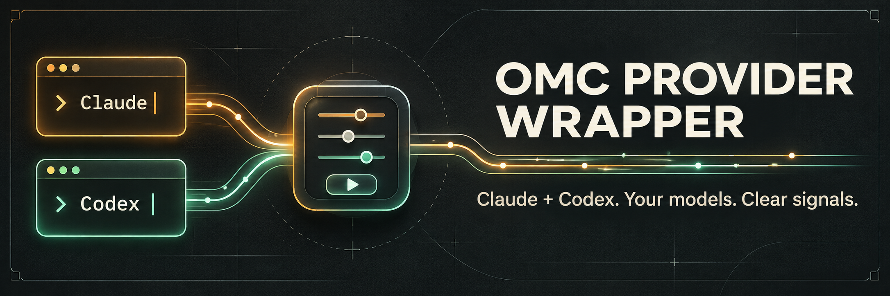

# OMC Provider Wrapper

Run **Claude and Codex through one local wrapper** with [oh-my-claudecode](https://github.com/Yeachan-Heo/oh-my-claudecode). Choose models per provider or per run, keep native terminal tools working, and send observed model changes, policy blocks, and recovery signals back to the Claude orchestrator.

## Install

Linux · Python 3.12+ · Node 22+ · npm · tmux · curl · make · C++ compiler.

```bash
git clone https://github.com/Bit-Loop/omc-provider-wrapper.git
cd omc-provider-wrapper
./install.sh
export PATH="$HOME/.local/bin:$PATH"
claude auth login
codex login
```

The installer fetches pinned OMC and its locked dependencies, installs missing provider CLIs, creates a private local credential, and starts a user service. Existing Claude settings and replaced launchers are backed up. [Install options and removal →](docs/install.md)

## Use

```bash
# Pick your defaults interactively; exact custom model IDs are accepted.
omc models select
omc models show

# Or choose both models for one run.
omc --claude-model opus --codex-model YOUR_CODEX_MODEL launch

# Ask either provider through the local HTTP wrapper.
omc ask claude --model sonnet --prompt "Review this design"
omc ask codex --model YOUR_CODEX_MODEL --prompt "Check this approach"

# See provider outcomes and observed model information.
omc wrapper status --json
```

Durable goals work with the same wrapper:

```bash
omc ultragoal create-goals --brief-file YOUR_BRIEF.md --claude-goal-mode aggregate
omc --claude-model opus --codex-model YOUR_CODEX_MODEL launch --yolo
```

`--yolo` enables native permission bypass. Native CLI sessions retain native tools; HTTP advisors use read-only settings. The wrapper reports provider signals when exposed; unknown model or block information stays unknown. It does not force model downgrades or route around policy blocks.

[Architecture & OMC changes](docs/integration.md) · [Testing](docs/testing.md) · [MIT license](LICENSE)
